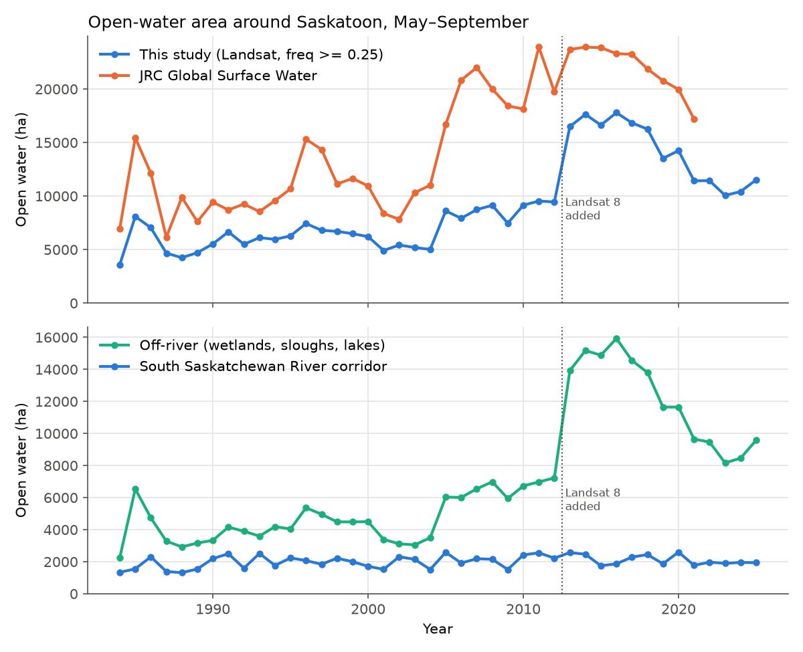
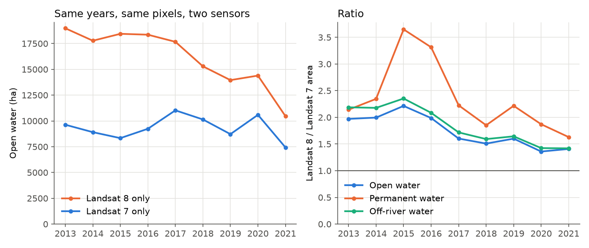
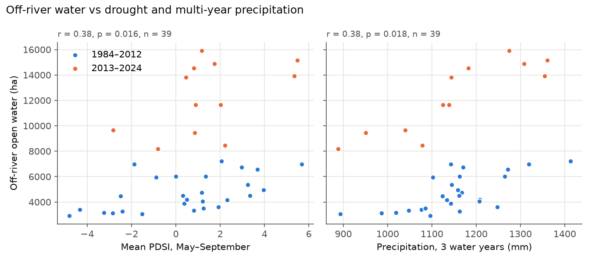
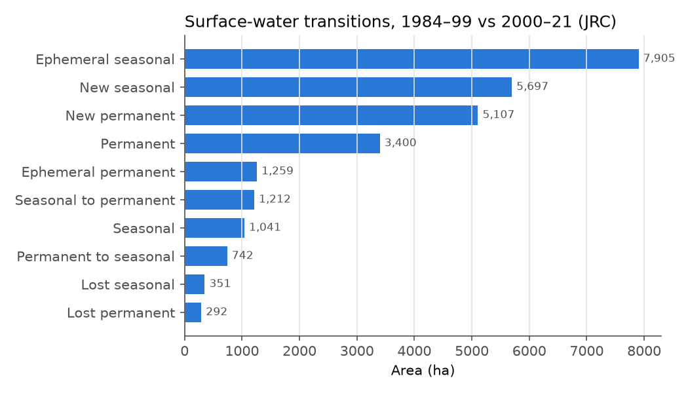
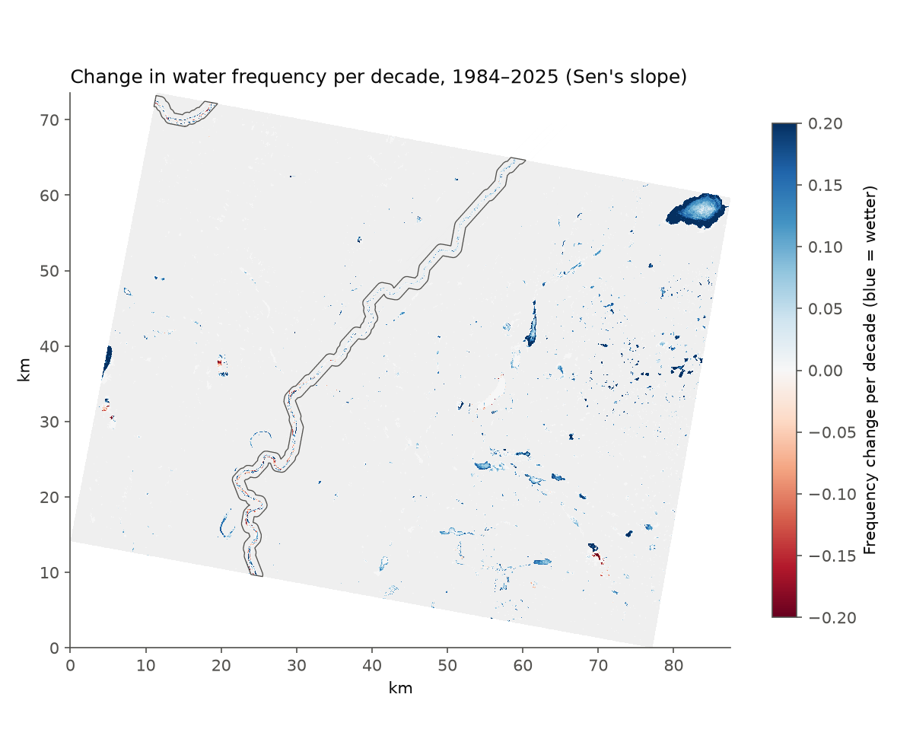
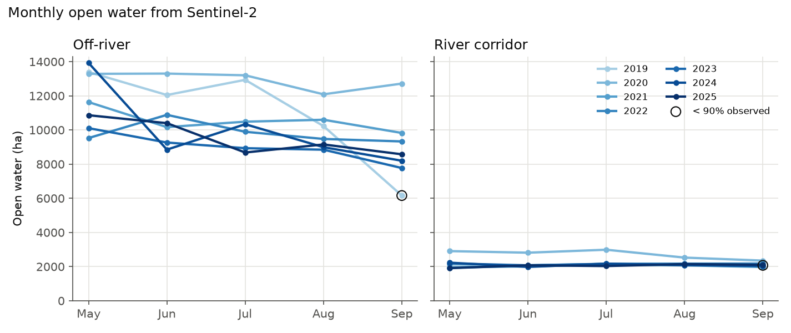

# Surface Water Dynamics — Saskatoon, Saskatchewan (Google Earth Engine)

Maps open surface water around Saskatoon from every clear Landsat scene since 1984. It separates the South Saskatchewan River from off-river water (prairie pothole wetlands, sloughs and lakes), checks the results against JRC Global Surface Water, maps where the landscape is getting wetter or drier, and tests how wetland area responds to precipitation and drought.

## Research question
How has open water around Saskatoon changed since 1984, and does off-river wetland area follow water-year precipitation and drought while the regulated South Saskatchewan River stays stable?

## Study area
A rectangle of about 80 × 60 km covering Saskatoon, the South Saskatchewan River and the prairie pothole wetlands to the east, including St. Denis National Wildlife Area. Change `AOI` to study somewhere else, for example Lake Diefenbaker: `ee.Geometry.Rectangle([-107.5, 50.6, -106.0, 51.4])`.

## Data (all in the Earth Engine catalog)
| Purpose | Dataset |
| --- | --- |
| Optical time series | Landsat 5, 7, 8, 9 Collection 2 Level 2 surface reflectance |
| Monthly water, 2019–present | Sentinel-2 L2A (harmonized) with Cloud Score+ |
| Reference water history | JRC Global Surface Water v1.4 (1984–2021) |
| River network | HydroSHEDS Free-Flowing Rivers |
| Climate | TerraClimate monthly precipitation and PDSI |

## Method
1. Masks cloud, dilated cloud, shadow and snow using `QA_PIXEL`. TM and ETM+ are harmonized to OLI (Roy et al. 2016).
2. Classifies water in each scene: (MNDWI > NDVI or MNDWI > EVI) and EVI < 0.1 (Zou et al. 2018).
3. Computes annual water frequency over May–September, i.e. the share of clear observations that are water. Pixels with fewer than 3 clear observations count as no data.
4. Open water is frequency ≥ 0.25 and permanent water is frequency ≥ 0.75. Area is split into the river corridor (HydroSHEDS reaches with more than 10,000 km² upstream, buffered by 750 m) and off-river water.
5. Compares annual area with the JRC Yearly Water History and summarises the JRC transition classes (1984–99 vs 2000–21).
6. Maps the per-pixel Sen's slope of annual water frequency for pixels with at least 20 years of data that were open water in at least one year.
7. Builds monthly water area from Sentinel-2 for 2019 to the present to show spring filling and summer drawdown.
8. Computes Pearson's r between off-river water area and water-year (Oct–Sep) precipitation and season PDSI, using only years with at least 90% of the AOI observed.
9. Checks sensor consistency by classifying Landsat 7 and Landsat 8 separately for 2013–2021, on the pixels both observed.

## How to run
1. Sign up at [code.earthengine.google.com](https://code.earthengine.google.com) with a Google account (free for research and education).
2. Paste `saskatoon_surface_water.js` into a new script and click **Run**.
3. Charts appear in the **Console** and layers on the map. Console charts use a 90 m preview, so small wetlands are undercounted there. Use the exported 30 m tables for analysis.
4. Start the exports from the **Tasks** tab. Files go to the `gee_saskatoon_water` folder in Google Drive.
5. Copy the CSVs into this folder and run `python make_figures.py` (needs pandas, matplotlib, scipy, tifffile, imagecodecs) to redraw the PNGs and print the statistics.

## Outputs
- `annual_water_area.csv`: per year, scene count, coverage, open/permanent/river/off-river water (ha), JRC water (ha), water-year precipitation and PDSI
- `s2_monthly_water_area.csv`: monthly Sentinel-2 water area by zone
- `jrc_transition_area.csv`: hectares per JRC transition class
- `sensor_check_L7_L8.csv`: open, permanent and off-river water from Landsat 7 alone vs Landsat 8 alone, 2013–2021
- `water_trend_<start>_<end>.tif`: trend per decade, years with data, maximum frequency, latest-year frequency, JRC occurrence, river corridor (30 m, EPSG:3978)
- `annual_water_frequency.tif`: one water-frequency band per year
- `annual_water_area.png`, `offriver_vs_climate.png`, `jrc_transitions.png`, `sensor_check_L7_L8.png`, `s2_monthly_water.png`, `water_trend_map.png`: figures from `make_figures.py`

## Results (1984–2025 run)
Every year had at least 90% of the AOI observed (lowest: 1993, 90.6%).

- **The landscape got wetter, and most of the gain was off-river.** JRC, processed independently, shows open water rising by about 440 ha per year from 1984 to 2021 (Kendall's τ = 0.55, p < 0.001). It peaked at about 24,000 ha in 2011–2016 and fell to 17,200 ha by 2021. This study's series rises too, but its trend is not usable (see the next point).
- **The South Saskatchewan River corridor is stable** at about 2,000 ha per year (Sen's slope 10 ha/yr, Kendall's τ = 0.19, p = 0.08), as you would expect for a river regulated by Gardiner Dam. Its year-to-year variation still follows drought (r = 0.54 with season PDSI, p < 0.001).
- **The 2013 jump in this study's series is a sensor artifact.** Off-river water roughly doubles between 2012 and 2013, while JRC rises only 20% and precipitation is unchanged. Up to 2012, JRC averages 1.9× this study's area; from 2013 it averages 1.4×. Do not compare absolute areas across 2013, and do not read this study's 1984–2025 Sen's slope (about 200 ha/yr) as a real trend.

- **The sensor check confirms the 2013 step and shows it is not a constant offset.** On the same pixels in the same years (2013–2021), Landsat 8 alone finds on average 1.74× as much open water as Landsat 7 alone (range 1.36–2.21) and 1.84× as much off-river water. The gap is largest for permanent water (2.36×, up to 3.65× in 2015), so it is not limited to borderline, part-season pixels. The ratio shrinks from about 2.0 in 2013–2016 to 1.4 in 2020–2021, so a single correction factor would not remove it. Possible causes are the remaining TM/ETM+ vs OLI band differences, Landsat 7 scan-line gaps reducing clear observations, and Landsat 7's orbit drift after 2017. Sentinel-2 agrees with the Landsat 8-era series (below), which suggests the TM/ETM+ years are the ones underestimated.

- **Wetlands respond to several years of precipitation, not just one.** Over the whole record, off-river water is only weakly related to a single water year's precipitation (r = 0.19, n.s.), because the 2013 step blurs the relationship. Within each sensor period the signal is clear:

  | Off-river water vs | 1984–2012 (n = 27–29) | 2013–2024 (n = 12) |
  | --- | --- | --- |
  | Water-year precipitation | r = 0.49, p = 0.007 | r = 0.48, p = 0.12 |
  | 3-year precipitation | **r = 0.67, p < 0.001** | **r = 0.88, p < 0.001** |
  | Season PDSI | r = 0.59, p = 0.001 | r = 0.48, p = 0.11 |

  Prairie pothole wetlands store water from one year to the next, so the sum over three years explains the most variation. The 2010–2014 wet run filled wetlands that stayed above their earlier levels for years afterwards.

- **JRC transitions show far more water gained than lost.** Between 1984–99 and 2000–21, about 10,800 ha became new permanent or new seasonal water, against about 640 ha of permanent or seasonal water lost.

- **Wetting is concentrated in off-river wetlands and lakes.** Using a threshold of ±0.05 frequency per decade, about 6,700 ha of off-river pixels got wetter and only 170 ha got drier. Inside the river corridor, 640 ha got wetter and 260 ha got drier, mostly where channels and sandbars shifted. The biggest gains are the large lake in the north-east of the AOI and the pothole wetlands east of the river. The per-pixel trend includes the 2013 sensor step, so read the map for where water changed, not for exact rates.

- **Sentinel-2 shows wetlands drying through each summer.** Averaged over 2019–2025, off-river water falls from about 11,800 ha in May to 8,900 ha in September, a 24% drawdown. The river corridor stays at about 2,100–2,250 ha in every month. In 2020, after the wet 2019 water year, wetlands stayed full all summer. September 2019 had only 80% of the AOI observed, so its low value is uncertain. Averaged over May–September, Sentinel-2 open water is 1.07× the Landsat annual area.

## Limitations
- Prairie wetlands are often smaller than a 30 m Landsat pixel, and emergent vegetation hides open water, so wetland area is underestimated. Sentinel-2 at 10–20 m does better.
- The water rule finds 1.4–2.2× more open water (up to 3.6× more permanent water) with Landsat 8 OLI than with Landsat 7 ETM+ on the same pixels, even after harmonization. This causes the 2013 step, and the offset changes from year to year. Using only permanent water does not avoid it.
- Only Landsat 7 (with scan-line gaps) was imaging in 2012, and some early years have few scenes. Check `coverage_pct` before reading trends.
- Snow and ice can remain in early May. The snow bit masks most of it, but early-season ice can still be misclassified.
- The Zou et al. rule was calibrated on Landsat. It is applied to Sentinel-2 without recalibration.
- The South Saskatchewan River has been regulated by Gardiner Dam (Lake Diefenbaker) since 1967, so river extent reflects dam releases rather than local climate.
- The HydroSHEDS river line is approximate. Wetlands right next to the river fall inside the corridor.
- JRC v1.4 ends in 2021, and TerraClimate lags the present by about a year.
- The per-pixel Sen's slope map has no significance test. Kendall's τ is reported only for the area time series.

## Next steps
- Fix the sensor step: recalibrate the water thresholds separately for TM/ETM+ and OLI (for example against Sentinel-2 or JRC in overlap years), or analyse 1984–2012 and 2013 onward as separate series.
- Compare river water extent with discharge at Water Survey of Canada gauge 05HG001 (South Saskatchewan River at Saskatoon, HYDAT).
- Add Sentinel-1 SAR to map water under cloud and during spring flooding.
- Validate against the Canadian Wetland Inventory or St. Denis field observations.
- Add a per-pixel Mann-Kendall test, and lagged climate terms (e.g. previous year's precipitation).

## References
- Abatzoglou, J.T. et al. (2018). TerraClimate, a high-resolution global dataset of monthly climate and climatic water balance from 1958–2015. *Scientific Data*, 5, 170191.
- Lehner, B. & Grill, G. (2013). Global river hydrography and network routing: baseline data and new approaches to study the world's large river systems. *Hydrological Processes*, 27, 2171–2186.
- Pasquarella, V.J. et al. (2023). Comprehensive quality assessment of optical satellite imagery using weakly supervised video learning. *CVPR Workshops*, 2125–2135.
- Pekel, J.-F. et al. (2016). High-resolution mapping of global surface water and its long-term changes. *Nature*, 540, 418–422.
- Roy, D.P. et al. (2016). Characterization of Landsat-7 to Landsat-8 reflective wavelength and normalized difference vegetation index continuity. *Remote Sensing of Environment*, 185, 57–70.
- Sen, P.K. (1968). Estimates of the regression coefficient based on Kendall's tau. *Journal of the American Statistical Association*, 63, 1379–1389.
- Zou, Z. et al. (2018). Divergent trends of open-surface water body area in the contiguous United States from 1984 to 2016. *PNAS*, 115, 3810–3815.

Author: Uday Karmoker
